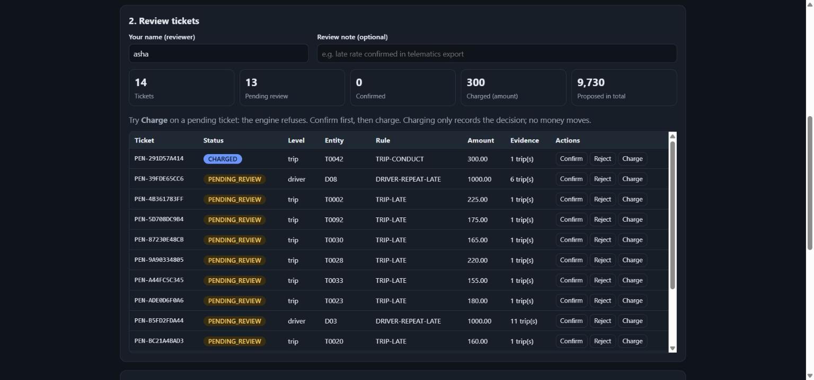

# Penalty Rules Engine


**[Try the live demo](https://amanksingh633.github.io/penalty-rules-engine/)**: runs in your browser, nothing to
install, nothing uploaded.

[](https://amanksingh633.github.io/penalty-rules-engine/)

Replace a penalty spreadsheet with versioned rules. The engine evaluates trip data against rules
at four levels (**trip, driver, vehicle, vendor**), opens a **review ticket** for every hit, and
will not charge anything until a **named human confirms it**. Every step lands in a
**hash-chained audit log** so history cannot be quietly edited.

> Independent, generic implementation built on synthetic data (random trips, fictional vehicle
> and driver IDs). It contains no employer code, customer data, or real contract terms.

## How it works

```text
trips.csv ──┐
            ├─► evaluate ─► findings ─► tickets (PENDING_REVIEW)
rules.json ─┘                               │
                              confirm / reject (named reviewer + note)
                                            │
                                 CONFIRMED ─► charge ─► CHARGED
                                            │
                          every step ─► audit.jsonl (hash chain)
```

- **Two evidence signals.** `telematics` rules look at lateness (scheduled vs actual arrival);
  `review` rules look at conduct (rider ratings and conduct flags). Each ticket lists the exact
  trips that triggered it.
- **Four levels.** The same rule format works per trip, or aggregated per driver, vehicle, or
  vendor, with a `min_trips` guard so small samples do not trigger penalties.
- **Human in the loop.** `charge` on an unconfirmed or rejected ticket is refused. Confirming
  needs a reviewer name; the note is recorded.
- **Idempotent.** Ticket IDs are derived from rule + entity + evidence, so re-running on the same
  data creates nothing new.
- **Tamper-evident.** Each audit record includes the hash of the previous one;
  `verify-audit` detects edited or deleted records.
- **Validated config.** Bad rules (unknown metric, bad operator, duplicate IDs) fail on load, not
  halfway through a run.

## Live demo

The demo page loads the real `penalty_engine` package into your browser with
[Pyodide](https://pyodide.org) (WebAssembly). Evaluate the sample trips, then try to charge a
pending ticket (the engine refuses), confirm and charge it, and use "Simulate tampering" to watch
the audit chain catch an edited record. The files under `docs/` are copies of `src/` kept in
sync by `scripts/sync_demo.py` and checked by a test.

## Quick start

```bash
git clone https://github.com/amanksingh633/penalty-rules-engine
cd penalty-rules-engine
pip install -e .          # no runtime dependencies

penalty-engine evaluate sample_data/trips.csv sample_data/rules.json
penalty-engine list --status PENDING_REVIEW
penalty-engine confirm PEN-C4BFF5BDC0 --reviewer asha --note "late rate confirmed"
penalty-engine charge  PEN-C4BFF5BDC0 --actor billing-bot
penalty-engine verify-audit
```

Real output on the bundled sample data:

```text
$ penalty-engine evaluate sample_data/trips.csv sample_data/rules.json
14 findings, 14 new tickets (all PENDING_REVIEW)
TICKET          STATUS          LEVEL    ENTITY    RULE                     AMOUNT
PEN-B5FD2FDA44  PENDING_REVIEW  driver   D03       DRIVER-REPEAT-LATE      1000.00
...

$ penalty-engine charge PEN-C4BFF5BDC0 --actor billing-bot
error: cannot charge PEN-C4BFF5BDC0: status is PENDING_REVIEW, needs CONFIRMED

$ penalty-engine confirm PEN-C4BFF5BDC0 --reviewer asha --note "late rate confirmed"
PEN-C4BFF5BDC0 -> CONFIRMED by asha

$ penalty-engine charge PEN-C4BFF5BDC0 --actor billing-bot
PEN-C4BFF5BDC0 -> CHARGED (5000.00)

$ penalty-engine verify-audit
audit log intact
```

`charge` records the decision only; it does not move money. Hooking it to a real billing system
is the integration point.

## Rule format

```json
{
  "id": "DRIVER-REPEAT-LATE",
  "level": "driver",
  "signal": "telematics",
  "metric": "late_trip_count",
  "op": ">=",
  "value": 5,
  "min_trips": 8,
  "penalty": { "type": "flat", "amount": 1000 }
}
```

- Metrics: `trip_count`, `late_trip_count`, `late_rate`, `total_late_minutes`,
  `low_rating_count`, `avg_rating`, `conduct_flag_count`.
- Penalties: `flat` (`amount`) or `per_unit` (`metric`, `rate`, optional `cap`).
- Top-level `grace_minutes` and `low_rating_threshold` define "late" and "low-rated".

## Project layout

```text
src/penalty_engine/
  models.py   trips, metrics     rules.py   rule loading and validation
  engine.py   evaluation         store.py   tickets, workflow, audit chain
  cli.py      command line
docs/         GitHub Pages live demo (Pyodide) + screenshot
scripts/      sync_demo.py copies the package and sample data into docs/
sample_data/  synthetic trips + rules, and the generator script
tests/        26 tests: rules, workflow gates, idempotency, audit tampering, CLI, demo
```

## Development

```bash
pip install -e ".[dev]"
ruff check . && pytest
```

## Notes

Built with AI assistance (Claude). The test suite pins the behaviour described above.

## License

MIT
